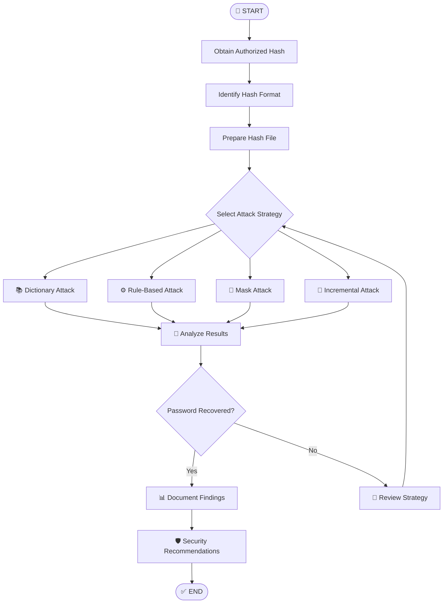

 <div align="center">


<br/>


<br/><br/>


### 🔐 PASSWORD SECURITY • HASH ANALYSIS • ETHICAL HACKING

**Understand the Hash. Analyze the Weakness. Strengthen the Defense.**

</div>

---

# 🟢 01. ABOUT THIS PROJECT

Welcome to my **John the Ripper Mastery** repository!

This repository documents my hands-on journey of learning John the Ripper, a powerful password security auditing tool used to assess password strength and identify weak password practices.

🎯 **My Learning Objectives**

- 🔍 Understand password hashing and authentication.
- 🧬 Identify and analyze different hash formats.
- 📚 Master dictionary and wordlist attacks.
- ⚙️ Understand rule-based password mutations.
- 🎯 Learn mask and incremental attacks.
- 🧪 Perform practical password auditing labs.
- 📊 Analyze cracking performance and results.
- 🛡️ Understand password security and defensive practices.

> ⚠️ All practical exercises are performed on self-created hashes, owned systems, or explicitly authorized labs.

---

# 🟣 02. HOW PASSWORD CRACKING WORKS

Understanding the underlying process is more important than memorizing commands.

```text
       🔐 ORIGINAL PASSWORD
                |
                ▼
        🧬 HASH GENERATION
                |
                ▼
          🔎 HASH FILE
                |
                ▼
       ⚡ JOHN THE RIPPER
                |
       ┌────────┼────────┐
       ▼        ▼        ▼
    📚 WORDLIST ⚙️ RULES 🎯 MASKS
       |        |        |
       └────────┼────────┘
                ▼
        🔬 HASH COMPARISON
                |
          ┌─────┴─────┐
          ▼           ▼
       ✅ MATCH    ❌ NO MATCH
          |           |
          ▼           ▼
      📖 ANALYSIS   🔄 CONTINUE
          |
          ▼
     🛡️ SECURITY REPORT
```

### 🔬 Hashing vs Encryption

| 🔐 Hashing | 🔒 Encryption |
|---|---|
| One-way operation | Reversible with key |
| No decryption key | Requires decryption key |
| Password storage | Data confidentiality |
| SHA-256 | AES |

---

# 🟠 03. ENVIRONMENT SETUP

### 💻 Install John the Ripper

```bash
sudo apt update
sudo apt install john -y
```

### 🔍 Verify Installation

```bash
john --version
john --help
```

### 📋 Explore Supported Formats

```bash
john --list=formats
```

### ⚙️ Check Build Information

```bash
john --list=build-info
```

### 📚 Prepare RockYou Wordlist

```bash
sudo gzip -dk /usr/share/wordlists/rockyou.txt.gz
```

Check:

```bash
ls -lh /usr/share/wordlists/
```

---

# 🟢 04. BEGINNER LEVEL — CORE FUNDAMENTALS

### 🧬 4.1 Generate Your First Hash

```bash
echo -n "hello123" | sha256sum
```

### 📁 4.2 Create a Hash File

```bash
echo "PASTE_HASH_HERE" > hash.txt
```

### 📚 4.3 Dictionary Attack

```bash
john --wordlist=/usr/share/wordlists/rockyou.txt hash.txt
```

### 🔓 4.4 Display Recovered Password

```bash
john --show hash.txt
```

### 🎯 4.5 Specify Hash Format

```bash
john --format=Raw-SHA256 --wordlist=rockyou.txt hash.txt
```

### 🔍 4.6 Explore Available Formats

```bash
john --list=formats
```

**🎯 Learning Goal:** Understand hash input, formats, wordlists, and the basic password auditing workflow.

---

# 🟡 05. INTERMEDIATE LEVEL — ATTACK TECHNIQUES

## 📚 5.1 Dictionary Attack

Tests candidate passwords from a wordlist.

```bash
john --wordlist=rockyou.txt hash.txt
```

## 👤 5.2 Single Crack Mode

Uses account information and associated fields to generate password candidates.

```bash
john --single hash.txt
```

## ⚙️ 5.3 Rule-Based Attack

Modifies dictionary words to generate password variations.

```bash
john --wordlist=rockyou.txt --rules hash.txt
```

Example transformations:

```text
password
Password
password123
Password123
p@ssword
```

## 🔄 5.4 Incremental Attack

Generates character combinations according to the selected incremental configuration.

```bash
john --incremental hash.txt
```

## 🎯 5.5 Mask-Based Attack

Useful when the password structure is known.

```bash
john --mask='?d?d?d?d' hash.txt
```

### 🎨 Mask Character Reference

| Symbol | Meaning |
|---|---|
| `?l` | Lowercase letters |
| `?u` | Uppercase letters |
| `?d` | Digits |
| `?s` | Special characters |
| `?a` | All supported character classes |
| `?h` | Lowercase hexadecimal |
| `?H` | Uppercase hexadecimal |

Example:

```bash
john --mask='?u?l?l?l?d?d' hash.txt
```

## 💾 5.6 Session Management

Start a named session:

```bash
john --session=my_lab hash.txt
```

Check status:

```bash
john --status=my_lab
```

Restore:

```bash
john --restore=my_lab
```

## 📊 5.7 Display Results

```bash
john --show hash.txt
```

**🎯 Learning Goal:** Master password candidate generation, attack strategies, masks, and session management.

---

# 🔴 06. ADVANCED LEVEL — PROFESSIONAL PASSWORD AUDITING

## 🧬 6.1 Hash Identification & Analysis

Study these formats and their security characteristics:

| Hash / Format | Application |
|---|---|
| MD5 | Legacy hashing |
| SHA-1 | Legacy cryptographic hashing |
| SHA-256 | General-purpose hashing |
| SHA-512 | General-purpose hashing |
| bcrypt | Password hashing |
| NTLM | Windows authentication |
| Linux crypt | Unix/Linux password storage |
| PDF formats | Document password auditing |
| ZIP formats | Archive password auditing |

> ⚠️ A hash-looking string does not always reveal its exact algorithm. Confirm the format using reliable identification and source context.

## ⚙️ 6.2 Custom Rule-Based Attacks

Explore:

- 🔠 Character transformations
- 🔄 Case modifications
- ➕ Append and prepend operations
- 🔁 Character duplication
- 🎭 Character substitutions
- 🧠 Custom password mutation strategies

```bash
john --wordlist=rockyou.txt --rules hash.txt
```

Explore available rules:

```bash
john --list=rules
```

## 🎯 6.3 Custom Character Sets

Understand custom character classes and mask configuration.

```bash
john --mask='?1?1?1?1' --1='abc123' hash.txt
```

## 🚀 6.4 Performance Benchmarking

```bash
john --test
```

Specific format:

```bash
john --test --format=Raw-SHA256
```

Study:

- ⚡ Hashes per second
- 🧠 CPU utilization
- 🎮 GPU support and limitations
- 📊 Algorithm performance
- 💾 Memory requirements

## 🧪 6.5 External Mode

Explore custom candidate-generation logic.

Topics:

- External mode syntax
- Candidate generation
- Character filtering
- Custom password policies

## 🔥 6.6 Jumbo Edition

Explore extended features:

- Additional hash formats
- PDF password auditing
- ZIP password auditing
- Office document formats
- SSH-related formats
- Extended plugins and capabilities

---

# 🧪 07. PRACTICAL LABS & CHALLENGES

| Lab | Practical Exercise | Level |
|---|---|---|
| 01 | Generate Your First Hash | 🟢 Beginner |
| 02 | Crack a SHA-256 Test Hash | 🟢 Beginner |
| 03 | RockYou Wordlist | 🟢 Beginner |
| 04 | Hash Format Selection | 🟢 Beginner |
| 05 | Dictionary Attack | 🟡 Intermediate |
| 06 | Single Crack Mode | 🟡 Intermediate |
| 07 | Rule-Based Attack | 🟡 Intermediate |
| 08 | Incremental Attack | 🟡 Intermediate |
| 09 | Mask-Based Attack | 🟡 Intermediate |
| 10 | Session Restoration | 🟡 Intermediate |
| 11 | PDF Password Auditing | 🔴 Advanced |
| 12 | ZIP Password Auditing | 🔴 Advanced |
| 13 | Custom Rule Development | 🔴 Advanced |
| 14 | Performance Benchmarking | 🔴 Advanced |
| 15 | Complete Password Security Audit | 🔴 Advanced |

---

# 🧠 08. COMPLETE PASSWORD AUDITING WORKFLOW



---

# 🧰 09. COMMAND CENTER — QUICK REFERENCE

| Command | Function |
|---|---|
| `john --help` | 📖 Help menu |
| `john --version` | ℹ️ Version |
| `john --list=formats` | 🔍 Supported formats |
| `john --list=rules` | ⚙️ Available rules |
| `john --wordlist=file hash.txt` | 📚 Wordlist attack |
| `john --single hash.txt` | 👤 Single crack |
| `john --rules hash.txt` | 🔄 Rule-based attack |
| `john --incremental hash.txt` | 🔢 Incremental mode |
| `john --mask='?d?d?d?d' hash.txt` | 🎯 Mask attack |
| `john --show hash.txt` | 🔓 Display results |
| `john --status` | 📊 Current status |
| `john --restore` | 💾 Restore session |
| `john --test` | ⚡ Benchmark |

---

# 📈 10. MY LEARNING PROGRESS

| Learning Module | Progress |
|---|:---:|
| 🛠️ Installation & Setup | ⬜ |
| 🧬 Hash Fundamentals | ⬜ |
| 🔍 Hash Identification | ⬜ |
| 📚 Dictionary Attacks | ⬜ |
| 👤 Single Crack Mode | ⬜ |
| ⚙️ Rule-Based Attacks | ⬜ |
| 🔄 Incremental Attacks | ⬜ |
| 🎯 Mask Attacks | ⬜ |
| 💾 Session Management | ⬜ |
| 🔬 Advanced Hash Formats | ⬜ |
| 🧪 Custom Rules | ⬜ |
| 🔥 Jumbo Edition | ⬜ |
| 🧰 Practical Labs | ⬜ |
| 🛡️ Security Reporting | ⬜ |

---

# 🌍 11. LEARNING RESOURCES

<div align="center">

<a href="https://www.openwall.com/john/">

</a>

<a href="https://github.com/openwall/john">

</a>

<a href="https://www.kali.org/tools/john/">

</a>

<a href="https://www.openwall.com/john/doc/">

</a>

<a href="https://tryhackme.com/">

</a>

<a href="https://www.hackthebox.com/">

</a>

</div>

---

# 👨‍💻 12. PROJECT CREATOR

<div align="center">


### 🔐 OMJEE OJHA

**Cybersecurity | Ethical Hacking | Security Research**

🧠 Learning • 🔬 Researching • 💻 Practicing • 🛡️ Securing

<br/>


<br/><br/>

### ⚡ THINK LIKE AN ATTACKER. DEFEND LIKE A PROFESSIONAL.


</div>

---

> ⚠️ **DISCLAIMER:** This repository is intended strictly for educational purposes, password security research, and authorized security assessments. Never use these techniques against systems, accounts, or password hashes without explicit permission.
