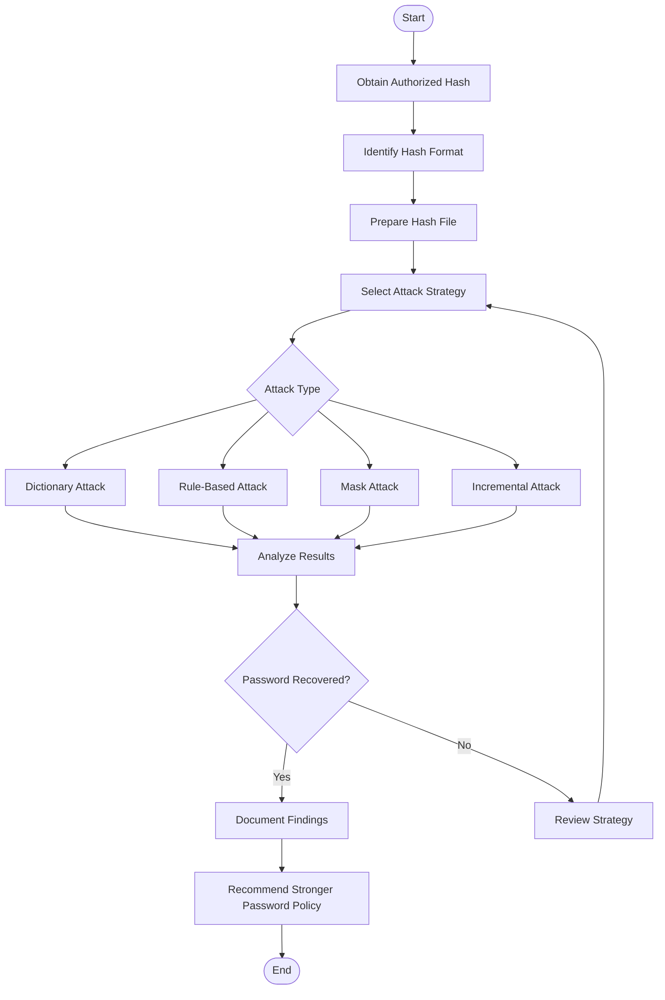

# 🔐 JOHN THE RIPPER — Password Cracking Mastery

\<div align="center">

# ⚡ JOHN THE RIPPER ⚡

### From Zero to Advanced | Practical Password Security Lab

\
\
\
\

\

**Understand • Analyze • Crack • Audit • Secure**

*An end-to-end practical journey into password security and hash auditing.*

\</div>

---

## 📌 About This Repository

Welcome to my John the Ripper learning repository!

This repository documents my practical journey from beginner to advanced level in **John the Ripper**, one of the most popular password auditing tools.

The goal is not just to memorize commands but to understand:

- How password hashing works.
- How password hashes are identified.
- How John the Ripper processes hashes.
- How wordlist-based attacks work.
- How rules generate password variations.
- How incremental and mask attacks work.
- How to analyze cracking results.
- How to identify weak password practices.
- How to improve password security.

> ⚠️ All practical exercises are performed on self-created hashes, owned systems, or explicitly authorized labs.

---

# 🧠 01. How Password Cracking Works

Before using John, understand the underlying concept.

```text
       USER PASSWORD
             |
             ▼
      PASSWORD HASHING
             |
             ▼
       HASH GENERATED
             |
             ▼
    JOHN THE RIPPER
             |
       ┌─────┴─────┐
       ▼           ▼
   Wordlist     Password
    Attack      Variations
       |           |
       └─────┬─────┘
             ▼
       HASH COMPARISON
             |
       ┌─────┴─────┐
       ▼           ▼
      MATCH      NO MATCH
       |           |
       ▼           ▼
   PASSWORD     CONTINUE
   RECOVERED     SEARCHING
```

### Hashing vs Encryption

| Hashing                   | Encryption               |
| ------------------------- | ------------------------ |
| One-way operation         | Reversible with key      |
| No decryption key         | Requires decryption key  |
| Used for password storage | Used for confidentiality |
| Example: SHA-256          | Example: AES             |

---

# 🛠️ 02. Environment Setup

### Install John the Ripper

```bash
sudo apt update
sudo apt install john -y
```

### Check Installation

```bash
john --version
```

### Check Supported Formats

```bash
john --list=formats
```

### Check Build Information

```bash
john --list=build-info
```

### Wordlist Setup

```bash
sudo gzip -dk /usr/share/wordlists/rockyou.txt.gz
```

Check:

```bash
ls -lh /usr/share/wordlists/
```

---

# 🟢 03. Beginner Level — Core Fundamentals

### 3.1 Understanding John the Ripper

```bash
john --help
```

Important commands:

| Command         | Purpose                       |
| --------------- | ----------------------------- |
| `john`          | Start cracking                |
| `--wordlist`    | Wordlist attack               |
| `--show`        | Show recovered passwords      |
| `--format`      | Specify hash format           |
| `--rules`       | Apply password mutation rules |
| `--incremental` | Incremental attack            |
| `--mask`        | Mask-based attack             |
| `--restore`     | Resume previous session       |
| `--session`     | Name a cracking session       |
| `--test`        | Performance benchmark         |

### 3.2 Generate Your Own Hash

Generate a SHA-256 hash:

```bash
echo -n "hello123" | sha256sum
```

Create a hash file:

```bash
echo "PASTE_HASH_HERE" > hash.txt
```

### 3.3 Basic Wordlist Attack

```bash
john --wordlist=/usr/share/wordlists/rockyou.txt hash.txt
```

### 3.4 Display Recovered Password

```bash
john --show hash.txt
```

### 3.5 Specify Hash Format

```bash
john --format=Raw-SHA256 --wordlist=rockyou.txt hash.txt
```

### 3.6 Check Available Formats

```bash
john --list=formats
```

**Learning Objective:** Understand hash input, hash formats, wordlists, and basic cracking workflow.

---

# 🟡 04. Intermediate Level — Attack Techniques

## 4.1 Dictionary Attack

Tests passwords from an existing wordlist.

```bash
john --wordlist=rockyou.txt hash.txt
```

## 4.2 Single Crack Mode

Uses information associated with usernames and GECOS fields to generate password candidates.

```bash
john --single hash.txt
```

## 4.3 Rule-Based Attack

Rules modify dictionary words to generate variations.

```bash
john --wordlist=rockyou.txt --rules hash.txt
```

Examples of password transformations:

```text
password
Password
password123
Password123
p@ssword
```

## 4.4 Incremental Attack

Tests character combinations based on configured incremental modes.

```bash
john --incremental hash.txt
```

## 4.5 Mask Attack

Useful when you know the password structure.

```bash
john --mask='?d?d?d?d' hash.txt
```

Mask symbols:

| Symbol | Meaning                         |
| ------ | ------------------------------- |
| `?l`   | Lowercase letters               |
| `?u`   | Uppercase letters               |
| `?d`   | Digits                          |
| `?s`   | Special characters              |
| `?a`   | All supported character classes |
| `?h`   | Hexadecimal lowercase           |
| `?H`   | Hexadecimal uppercase           |

Example:

```bash
john --mask='?u?l?l?l?d?d' hash.txt
```

## 4.6 Session Management

Start a named session:

```bash
john --session=my_lab hash.txt
```

Restore:

```bash
john --restore=my_lab
```

Show status:

```bash
john --status=my_lab
```

## 4.7 Show Results

```bash
john --show hash.txt
```

**Learning Objective:** Understand attack strategies, password mutations, masks, sessions, and recovery.

---

# 🔴 05. Advanced Level — Professional Password Auditing

## 5.1 Hash Identification

Understand the hash structure before selecting the appropriate format.

Study:

- MD5
- SHA-1
- SHA-256
- SHA-512
- bcrypt
- NTLM
- Linux crypt formats
- PDF password hashes
- ZIP password hashes

Remember: A hash-looking string does not always reveal its exact algorithm. Use reliable format identification and source context.

## 5.2 Custom Rule-Based Attacks

Learn:

- Rule syntax
- Character substitutions
- Append and prepend operations
- Case transformations
- Character duplication
- Password mutation strategies

Example:

```bash
john --wordlist=rockyou.txt --rules hash.txt
```

Inspect available rules:

```bash
john --list=rules
```

## 5.3 Custom Character Sets

Learn how to define custom character sets and use them with masks.

Example:

```bash
john --mask='?1?1?1?1' --1='abc123' hash.txt
```

## 5.4 Performance Benchmarking

```bash
john --test
```

Specific format benchmark:

```bash
john --test --format=Raw-SHA256
```

Understand:

- Hashes per second
- CPU performance
- GPU support and limitations
- Hash algorithm cost
- Memory requirements

## 5.5 External Mode

Explore custom candidate-generation logic using John configuration files.

Topics:

- External mode syntax
- Candidate generation
- Character filtering
- Custom password policies

## 5.6 Jumbo Edition

Explore advanced features available in the Jumbo build:

- Additional hash formats
- Archive formats
- SSH-related formats
- Office document formats
- PDF hash auditing
- Custom formats and plugins

---

# 🧪 06. Practical Labs

| Lab | Practical Task            | Level        |
| --- | ------------------------- | ------------ |
| 01  | Generate your first hash  | Beginner     |
| 02  | Crack a SHA-256 test hash | Beginner     |
| 03  | Use RockYou wordlist      | Beginner     |
| 04  | Specify hash formats      | Beginner     |
| 05  | Dictionary attack         | Intermediate |
| 06  | Rule-based attack         | Intermediate |
| 07  | Mask-based attack         | Intermediate |
| 08  | Incremental attack        | Intermediate |
| 09  | Session restoration       | Intermediate |
| 10  | PDF password auditing     | Advanced     |
| 11  | ZIP password auditing     | Advanced     |
| 12  | Custom rules              | Advanced     |
| 13  | Benchmark analysis        | Advanced     |
| 14  | Password policy audit     | Advanced     |

---

# 🔬 07. Complete Password Auditing Workflow



---

# 📊 08. Important Commands Cheat Sheet

| Command                           | Description       |
| --------------------------------- | ----------------- |
| `john --help`                     | Help menu         |
| `john --version`                  | Version           |
| `john --list=formats`             | Supported formats |
| `john --list=rules`               | Available rules   |
| `john --wordlist=file hash.txt`   | Wordlist attack   |
| `john --single hash.txt`          | Single crack mode |
| `john --rules hash.txt`           | Rule-based attack |
| `john --incremental hash.txt`     | Incremental mode  |
| `john --mask='?d?d?d?d' hash.txt` | Mask attack       |
| `john --show hash.txt`            | Display results   |
| `john --status`                   | Current status    |
| `john --restore`                  | Restore session   |
| `john --test`                     | Benchmark         |

---

# 🧰 09. Resources & Learning

### Official Resources

- [John the Ripper Official Website](https://www.openwall.com/john/)
- [John the Ripper GitHub Repository](https://github.com/openwall/john)
- [John the Ripper Documentation](https://www.openwall.com/john/doc/)
- [Kali Linux Tools Documentation](https://www.kali.org/tools/john/)

### Practice Platforms

- [TryHackMe](https://tryhackme.com/)
- [Hack The Box](https://www.hackthebox.com/)
- [OverTheWire](https://overthewire.org/)
- [PortSwigger Web Security Academy](https://portswigger.net/web-security)

---

# 📈 10. My Learning Progress

| Category                   | Status |
| -------------------------- | ------ |
| Installation & Setup       | ⬜      |
| Hash Fundamentals          | ⬜      |
| Wordlist Attacks           | ⬜      |
| Single Crack Mode          | ⬜      |
| Rule-Based Attacks         | ⬜      |
| Incremental Attacks        | ⬜      |
| Mask Attacks               | ⬜      |
| Session Management         | ⬜      |
| Advanced Formats           | ⬜      |
| Custom Rules               | ⬜      |
| Practical Labs             | ⬜      |
| Password Security Auditing | ⬜      |

---

# 🎯 11. Final Learning Goals

By completing this repository, I aim to:

- Understand password hashing and password security.
- Use John the Ripper confidently in Kali Linux.
- Identify and work with different hash formats.
- Understand different password-cracking techniques.
- Build custom wordlists and password rules.
- Perform authorized password security assessments.
- Document findings and recommend security improvements.

---

\<div align="center">

## 🔐 Learn the Weakness. Understand the Attack. Strengthen the Defense.

**CYBERSECURITY | PASSWORD AUDITING | ETHICAL HACKING**

\

*This repository is maintained for educational purposes and authorized security testing only.*

\</div>
