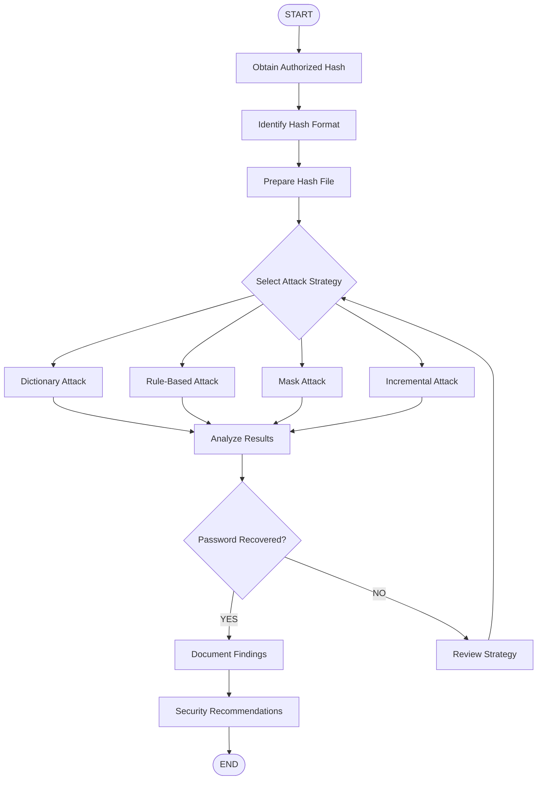

<!-- ======================================================= -->
<!--             JOHN THE RIPPER MASTERY                    -->
<!-- ======================================================= -->

<div align="center">


<br/>


<br/><br/>

**A HANDS-ON JOURNEY INTO PASSWORD SECURITY & HASH AUDITING**

*Breaking down password security, one hash at a time.*

</div>

---

## `01 // SYSTEM OVERVIEW`

> [!IMPORTANT]
> This repository documents my practical journey of mastering **John the Ripper**, from fundamental concepts to advanced password auditing techniques.

John the Ripper is a powerful password security auditing tool used to identify weak passwords through various password-candidate generation and hash-comparison techniques.

### MISSION OBJECTIVES

- Understand password hashing and authentication security.
- Identify different hash formats.
- Master dictionary and wordlist attacks.
- Explore rule-based and incremental attacks.
- Understand mask-based password generation.
- Perform practical password security assessments.
- Analyze results and document security weaknesses.

---

## `02 // CYBERSECURITY VISUALIZATION`

<div align="center">


<br/><br/>

### THE PASSWORD AUDITING PIPELINE

</div>

```text
             ┌──────────────────────┐
             │  AUTHORIZED HASH     │
             └──────────┬───────────┘
                        │
                        ▼
             ┌──────────────────────┐
             │   HASH IDENTIFICATION│
             └──────────┬───────────┘
                        │
                        ▼
             ┌──────────────────────┐
             │ JOHN THE RIPPER      │
             └──────────┬───────────┘
                        │
          ┌─────────────┼─────────────┐
          ▼             ▼             ▼
      DICTIONARY       RULES         MASKS
          │             │             │
          └─────────────┼─────────────┘
                        ▼
                HASH COMPARISON
                        │
                 ┌──────┴──────┐
                 ▼             ▼
              MATCH         NO MATCH
                 │             │
                 ▼             ▼
             ANALYSIS      REVIEW
                 │
                 ▼
          SECURITY REPORT
```

---

## `03 // INSTALLATION & ENVIRONMENT`

**Operating Environment:** Kali Linux

```bash
sudo apt update
sudo apt install john -y
```

Verify installation:

```bash
john --version
john --help
john --list=formats
john --list=build-info
```

Prepare RockYou:

```bash
sudo gzip -dk /usr/share/wordlists/rockyou.txt.gz
```

Verify:

```bash
ls -lh /usr/share/wordlists/
```

---

## `04 // BEGINNER LEVEL — CORE OPERATIONS`

### 01. Generate a SHA-256 Hash

```bash
echo -n "hello123" | sha256sum
```

### 02. Prepare a Hash File

```bash
echo "PASTE_HASH_HERE" > hash.txt
```

### 03. Dictionary Attack

```bash
john --wordlist=/usr/share/wordlists/rockyou.txt hash.txt
```

### 04. Display Recovered Passwords

```bash
john --show hash.txt
```

### 05. Specify Hash Format

```bash
john --format=Raw-SHA256 --wordlist=rockyou.txt hash.txt
```

### 06. Explore Supported Formats

```bash
john --list=formats
```

---

## `05 // INTERMEDIATE LEVEL — ATTACK TECHNIQUES`

<div align="center">


</div>

### Dictionary Attack

```bash
john --wordlist=rockyou.txt hash.txt
```

### Single Crack Mode

```bash
john --single hash.txt
```

### Rule-Based Attack

```bash
john --wordlist=rockyou.txt --rules hash.txt
```

### Incremental Mode

```bash
john --incremental hash.txt
```

### Mask-Based Attack

```bash
john --mask='?d?d?d?d' hash.txt
```

### Session Management

```bash
john --session=my_lab hash.txt
john --status=my_lab
john --restore=my_lab
```

### Mask Character Reference

| Symbol | Character Set |
|:---:|---|
| `?l` | Lowercase letters |
| `?u` | Uppercase letters |
| `?d` | Digits |
| `?s` | Special characters |
| `?a` | All supported character classes |
| `?h` | Lowercase hexadecimal |
| `?H` | Uppercase hexadecimal |

---

## `06 // ADVANCED LEVEL — DEEP DIVE`

**Advanced topics under investigation:**

| Domain | Topics |
|---|---|
| Hash Analysis | MD5, SHA-1, SHA-256, SHA-512 |
| Password Storage | bcrypt, Linux crypt, NTLM |
| Rule Engine | Custom rules, transformations |
| Candidate Generation | Incremental, masks, external mode |
| Performance | Benchmarking, CPU/GPU considerations |
| File Auditing | PDF, ZIP, Office formats |
| Jumbo Edition | Extended formats and capabilities |
| Reporting | Findings, evidence, recommendations |

### Benchmarking

```bash
john --test
```

```bash
john --test --format=Raw-SHA256
```

### Custom Character Set

```bash
john --mask='?1?1?1?1' --1='abc123' hash.txt
```

### Inspect Rules

```bash
john --list=rules
```

---

## `07 // ATTACK WORKFLOW — VISUAL MAP`



---

## `08 // PRACTICAL LABS & CHALLENGES`

| ID | Practical Exercise | Level |
|:---:|---|:---:|
| 01 | Generate Your First Hash | Beginner |
| 02 | Basic SHA-256 Auditing | Beginner |
| 03 | RockYou Wordlist | Beginner |
| 04 | Hash Format Selection | Beginner |
| 05 | Dictionary Attacks | Intermediate |
| 06 | Single Crack Mode | Intermediate |
| 07 | Rule-Based Attacks | Intermediate |
| 08 | Incremental Attacks | Intermediate |
| 09 | Mask-Based Attacks | Intermediate |
| 10 | Session Restoration | Intermediate |
| 11 | PDF Password Auditing | Advanced |
| 12 | ZIP Password Auditing | Advanced |
| 13 | Custom Rule Development | Advanced |
| 14 | Performance Benchmarking | Advanced |
| 15 | Complete Password Security Audit | Advanced |

---

## `09 // COMMAND CENTER — QUICK REFERENCE`

| Command | Function |
|---|---|
| `john --help` | Help menu |
| `john --version` | Version |
| `john --list=formats` | Supported formats |
| `john --list=rules` | Available rules |
| `john --wordlist=file hash.txt` | Dictionary attack |
| `john --single hash.txt` | Single crack |
| `john --rules hash.txt` | Rule-based attack |
| `john --incremental hash.txt` | Incremental mode |
| `john --mask='?d?d?d?d' hash.txt` | Mask attack |
| `john --show hash.txt` | Display results |
| `john --status` | Status |
| `john --restore` | Restore session |
| `john --test` | Benchmark |

---

## `10 // LEARNING PROGRESS`

| Learning Module | Status |
|---|:---:|
| Installation & Configuration | ⬜ |
| Hash Fundamentals | ⬜ |
| Hash Identification | ⬜ |
| Dictionary Attacks | ⬜ |
| Single Crack Mode | ⬜ |
| Rule-Based Attacks | ⬜ |
| Incremental Mode | ⬜ |
| Mask-Based Attacks | ⬜ |
| Session Management | ⬜ |
| Advanced Hash Formats | ⬜ |
| Custom Rules | ⬜ |
| Jumbo Edition | ⬜ |
| Practical Labs | ⬜ |
| Security Reporting | ⬜ |

---

## `11 // KNOWLEDGE BASE & RESOURCES`

<div align="center">

<a href="https://www.openwall.com/john/">

</a>

<a href="https://github.com/openwall/john">

</a>

<a href="https://www.kali.org/tools/john/">

</a>

<a href="https://www.openwall.com/john/doc/">

</a>

</div>

---

## `12 // PROJECT AUTHOR`

<div align="center">


### CYBERSECURITY ENTHUSIAST

**Learning | Researching | Practicing | Building**

*Focused on cybersecurity, ethical hacking, password security and practical security research.*

<br/>


<br/><br/>

**"KNOW THE ATTACK. UNDERSTAND THE WEAKNESS. MASTER THE DEFENSE."**


</div>

---

> [!CAUTION]
> **Ethical Use Only:** This repository is intended for educational purposes, password security research, and authorized security auditing. Never use these techniques against systems or password hashes without permission.</div>
