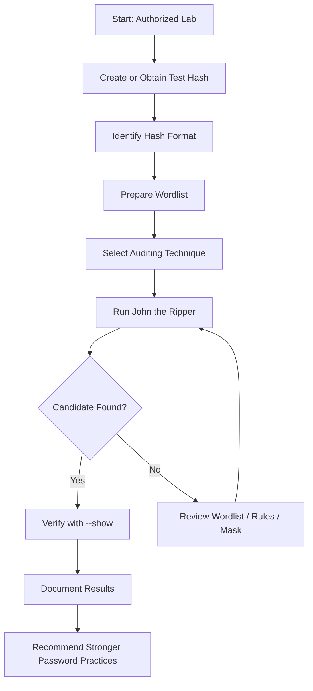
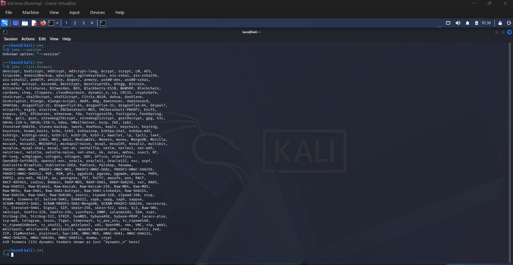
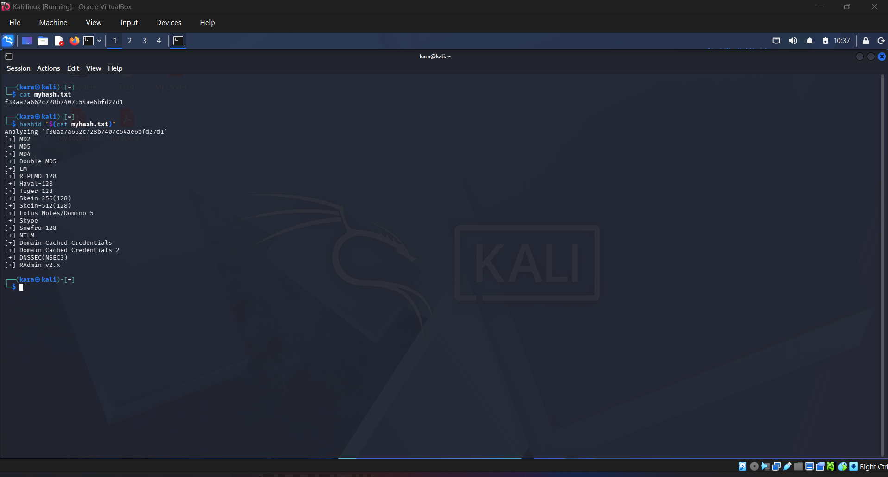
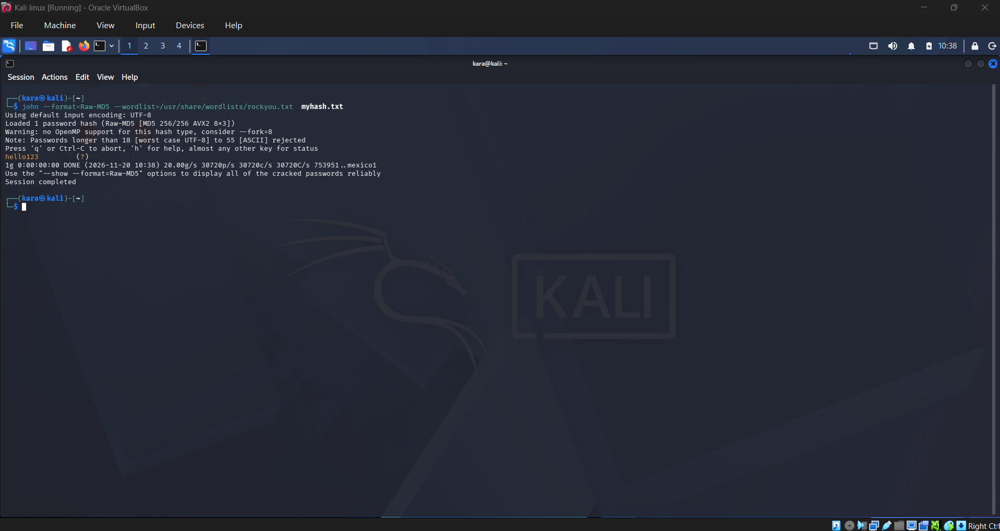
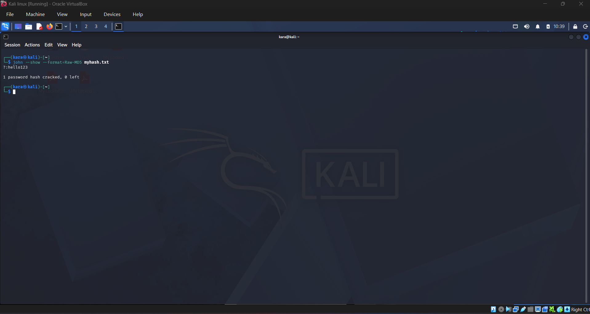
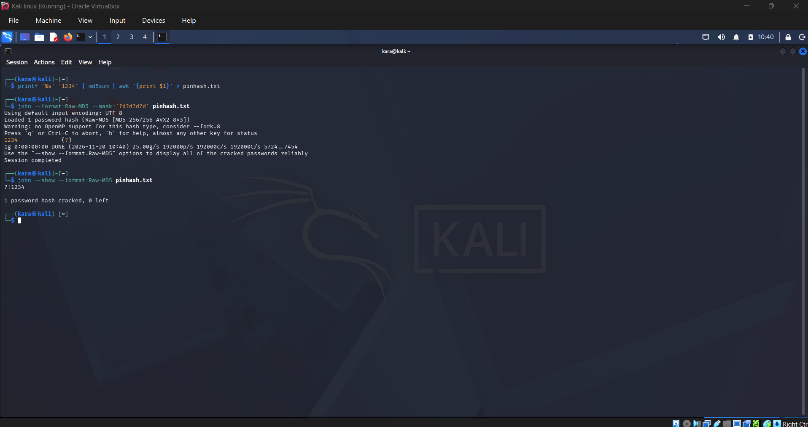
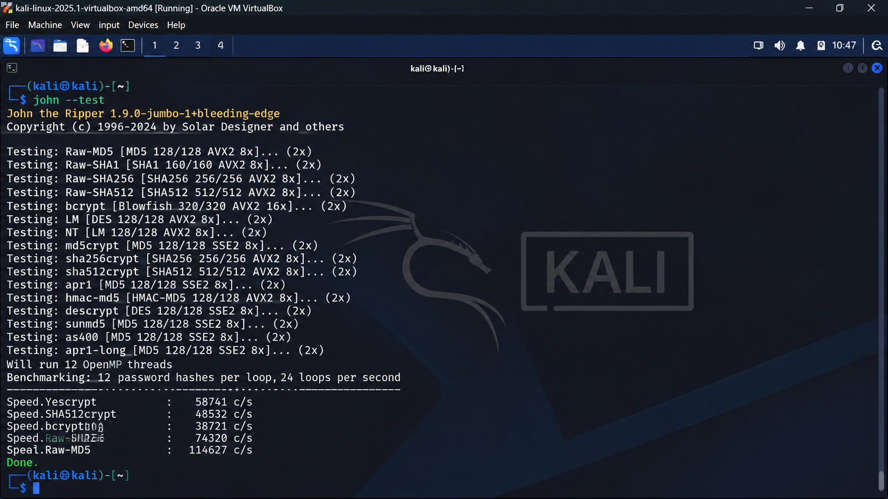

 <div align="center">


<br/>


</div>

---

## 👨‍💻 About This Repository

Welcome to **John The Ripper Mastery** — a practical learning repository dedicated to understanding password auditing with John the Ripper.

This repository documents my journey from beginner to advanced concepts through:

- Practical terminal commands
- Password hash identification
- Wordlist creation and management
- Dictionary-based password auditing
- Custom password rules
- Mask-based attacks
- Incremental mode
- Realistic lab exercises
- Practical screenshots and notes

**My goal:** Understand how password auditing works, develop practical cybersecurity skills, and learn how to identify weak password practices.

> Learn it. Execute it. Understand it. Document it.

## ⚡ What Is John The Ripper?

John the Ripper (JtR) is an open-source password security auditing and password recovery tool.

It supports multiple password hash formats and different techniques for testing password strength.

**Common use cases:**
- Auditing password strength.
- Testing password hashes in authorized environments.
- Recovering passwords from your own files.
- Understanding password security and hashing.
- Learning password auditing techniques.

## 🧠 Learning Roadmap

| Level | Topics |
|---|---|
| 🟢 Beginner | Installation, configuration, hash basics |
| 🟢 Beginner | Hash identification, wordlists |
| 🟣 Intermediate | Dictionary attacks, rules, sessions |
| 🟣 Intermediate | Custom wordlists, mask attacks |
| 🟠 Advanced | Incremental mode, format options |
| 🟠 Advanced | Performance testing, optimization |
| 🔴 Practical | Password auditing labs and reporting |

## 🛠️ 1. Installation & Setup

### Kali Linux

```bash
sudo apt update
sudo apt install john -y
```

Check installation:

```bash
john --version
```

View supported formats:

```bash
john --list=formats
```

Run a benchmark:

```bash
john --test
```

### Check Wordlists

```bash
ls /usr/share/wordlists/
```

If RockYou is compressed:

```bash
sudo gzip -dk /usr/share/wordlists/rockyou.txt.gz
```

Verify:

```bash
ls -lh /usr/share/wordlists/rockyou.txt
```

## 🔐 2. Understanding Password Hashes

A password hash is a fixed-length output generated from input data using a hashing algorithm.

Common hash algorithms:

| Algorithm | Common use / characteristics |
|---|---|
| MD5 | Legacy hashing |
| SHA-1 | Legacy hashing |
| SHA-256 | General-purpose cryptographic hashing |
| SHA-512 | General-purpose cryptographic hashing |
| bcrypt | Password hashing |
| NTLM | Windows authentication |

**Important:** Hashing is not encryption. A hash is not normally reversed to recover the original password. Password auditing tools test candidate passwords by calculating and comparing hashes.

### Generate a test hash

```bash
printf '%s' 'hello123' | md5sum
```

Generate SHA-256:

```bash
printf '%s' 'hello123' | sha256sum
```

## 🔍 3. Hash Identification

John can sometimes identify the hash format automatically.

Create a test hash file:

```bash
printf '%s\n' 'HASH_HERE' > myhash.txt
```

Try automatic detection:

```bash
john --show myhash.txt
```

For a controlled test using a known format:

```bash
john --format=Raw-MD5 --wordlist=wordlist.txt myhash.txt
```

Other useful options:

```bash
john --list=formats
```

```bash
john --show myhash.txt
```

**Note:** `HASH_HERE` is a placeholder. Replace it with a real hash generated for your own lab.

## 📚 4. Wordlists

A wordlist contains candidate passwords that can be tested during an audit.

### View RockYou

```bash
head /usr/share/wordlists/rockyou.txt
```

```bash
tail /usr/share/wordlists/rockyou.txt
```

Count entries:

```bash
wc -l /usr/share/wordlists/rockyou.txt
```

Create a custom wordlist:

```bash
nano custom.txt
```

Example contents:

```text
hello123
password123
admin123
welcome123
```

Use it:

```bash
john --wordlist=custom.txt myhash.txt
```

## ⚔️ 5. Dictionary Attack

Dictionary mode tests candidate passwords from a supplied wordlist.

```bash
john --wordlist=/usr/share/wordlists/rockyou.txt myhash.txt
```

Display recovered passwords:

```bash
john --show myhash.txt
```

Use a specific format:

```bash
john --format=Raw-SHA256 --wordlist=custom.txt myhash.txt
```

## ⚙️ 6. Single Crack Mode

Single mode uses information associated with a username or other fields in a supported input format to generate password candidates.

```bash
john --single passwd.txt
```

This mode is most useful with appropriately formatted input, rather than a file containing only a standalone hash.

## 🧬 7. Rules-Based Password Auditing

Rules modify candidate passwords to test common variations.

Examples include:
- Changing letter case.
- Adding numbers.
- Appending special characters.
- Making common character substitutions.

Run a wordlist with rules:

```bash
john --wordlist=custom.txt --rules myhash.txt
```

Use a named ruleset if it exists in your John configuration:

```bash
john --wordlist=custom.txt --rules=Wordlist myhash.txt
```

Rule availability depends on the installed John build and configuration.

## 🎯 8. Mask-Based Auditing

Mask mode tests passwords that follow a known character pattern.

Example: testing all four-digit numeric PINs in an authorized lab.

```bash
john --mask='?d?d?d?d' myhash.txt
```

Common mask characters:

| Symbol | Meaning |
|---|---|
| `?l` | Lowercase letters |
| `?u` | Uppercase letters |
| `?d` | Digits |
| `?s` | Special characters |
| `?a` | All supported character classes |

Example: six lowercase letters:

```bash
john --mask='?l?l?l?l?l?l' myhash.txt
```

## 🔢 9. Incremental Mode

Incremental mode generates candidate passwords according to the selected character set and configuration.

```bash
john --incremental myhash.txt
```

A named incremental mode can be selected if configured:

```bash
john --incremental=Digits myhash.txt
```

Use this mode carefully: the search space can become extremely large.

## ⏯️ 10. Sessions & Restore

Name a session:

```bash
john --session=my_lab --wordlist=custom.txt myhash.txt
```

Check session status:

```bash
john --status=my_lab
```

Restore a session:

```bash
john --restore=my_lab
```

Sessions help continue longer password-auditing tasks.

## 📊 11. Performance & Benchmarking

Run a benchmark:

```bash
john --test
```

Benchmark a specific format:

```bash
john --test --format=Raw-SHA256
```

Display format information:

```bash
john --list=formats
```

Performance depends on the hash algorithm, hardware, John build, and configuration.

## 🧪 12. Practical Lab Exercises

All labs should use hashes and files that you create yourself or are explicitly authorized to test.

| Lab | Practical task | Level |
|---|---|---|
| Lab 01 | Install John and inspect supported formats | Beginner |
| Lab 02 | Generate and identify test hashes | Beginner |
| Lab 03 | Create a custom wordlist | Beginner |
| Lab 04 | Test a known MD5 hash | Beginner |
| Lab 05 | Run a dictionary audit | Intermediate |
| Lab 06 | Experiment with password rules | Intermediate |
| Lab 07 | Test a four-digit PIN mask | Intermediate |
| Lab 08 | Explore incremental mode | Advanced |
| Lab 09 | Manage and restore sessions | Advanced |
| Lab 10 | Benchmark supported hash formats | Advanced |

### Example: Complete Controlled Lab

Generate a known MD5 hash:

```bash
printf '%s' 'hello123' | md5sum
```

Copy the hash value and save it:

```bash
echo 'PASTE_HASH_HERE' > myhash.txt
```

Create a small wordlist:

```bash
printf 'admin123\nhello123\npassword123\n' > custom.txt
```

Run John:

```bash
john --format=Raw-MD5 --wordlist=custom.txt myhash.txt
```

Display the result:

```bash
john --show --format=Raw-MD5 myhash.txt
```

This demonstrates the basic password-auditing workflow using a hash you generated yourself.

## 🔄 13. Password Auditing Workflow



## 📸 14. Practical Screenshots

The following screenshots will document my actual Kali Linux lab work.

### 01 — Installation & Environment



### 02 — Hash Identification



### 03 — Dictionary Attack



### 04 — Password Recovery Results



### 05 — Rule-Based Auditing


### 06 — Mask-Based Auditing



### 07 — Performance Benchmark



## 📂 15. Repository Structure

```text
john-the-ripper-mastery/
│
├── README.md
│
├── screenshots/
│   ├── 01-installation.png
│   ├── 02-hash-identification.png
│   ├── 03-dictionary-attack.png
│   ├── 04-cracking-results.png
│   ├── 05-rule-based-attack.png
│   ├── 06-mask-attack.png
│   └── 07-benchmark.png
│
├── beginner/
│   ├── installation.md
│   ├── hash-basics.md
│   └── wordlists.md
│
├── intermediate/
│   ├── dictionary-mode.md
│   ├── rules.md
│   └── mask-mode.md
│
├── advanced/
│   ├── incremental-mode.md
│   ├── sessions.md
│   └── benchmarking.md
│
└── practical-labs/
    ├── lab-01.md
    ├── lab-02.md
    └── lab-03.md
```

## 📋 16. Quick Command Cheat Sheet

| Command | Purpose |
|---|---|
| `john --version` | Check version |
| `john --list=formats` | List formats |
| `john --test` | Run benchmark |
| `john --show hashes.txt` | Show recovered passwords |
| `john --wordlist=words.txt hashes.txt` | Dictionary mode |
| `john --single passwd.txt` | Single mode |
| `john --wordlist=words.txt --rules hashes.txt` | Rules mode |
| `john --mask='?d?d?d?d' hashes.txt` | Four-digit mask |
| `john --incremental hashes.txt` | Incremental mode |
| `john --restore=session_name` | Restore session |

## 📈 17. Learning Progress

| Topic | Status |
|---|---|
| Installation | ⬜ |
| Hash fundamentals | ⬜ |
| Hash identification | ⬜ |
| Wordlists | ⬜ |
| Dictionary mode | ⬜ |
| Single mode | ⬜ |
| Rules | ⬜ |
| Mask mode | ⬜ |
| Incremental mode | ⬜ |
| Sessions | ⬜ |
| Benchmarking | ⬜ |
| Practical labs | ⬜ |

*Update the checkboxes as you complete each topic.*

## 📚 18. Learning Resources

- [John the Ripper Official Website](https://www.openwall.com/john/)
- [John the Ripper Documentation](https://www.openwall.com/john/doc/)
- [John the Ripper GitHub Repository](https://github.com/openwall/john)
- [Kali Linux Tools — John](https://www.kali.org/tools/john/)
- [Hashcat Wiki](https://hashcat.net/wiki/)

## 👨‍💻 About the Creator

<div align="center">


**Cybersecurity Learner | CSE Student | Ethical Hacking Enthusiast**

Learning cybersecurity through hands-on labs, practical experiments, and continuous improvement.

</div>

## ⚠️ Disclaimer

This repository is intended for educational purposes, authorized password auditing, and password recovery on systems or files you own or have explicit permission to test.

Do not use these techniques against unauthorized accounts, systems, or data. Always follow applicable laws and responsible security practices.

---

<div align="center">

### 💚 LEARN • PRACTICE • DOCUMENT • IMPROVE


**Made with curiosity and a passion for cybersecurity.**

</div>
